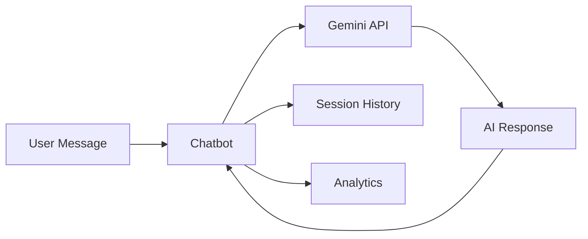

# 🤖 Gemini Chatbot

<div align="center">


**Gemini-Powered Chatbot with Analytics & Research Tools**

[]()
[](https://github.com/samalarakshithbabu/gemini-chatbot/issues)

</div>

---

## 🚀 Executive Summary

A **smart chatbot application** powered by Google Gemini API with analytics, research tools, and document processing capabilities. Features a modular architecture for experimentation and easy extension.

### What It Does



---

## ✨ Key Features

| Feature | Description |
|---------|-------------|
| **Interactive Chat** | Real-time communication via Streamlit |
| **Gemini Integration** | Google's Generative AI |
| **Extensible Architecture** | Easy domain-specific customization |
| **API Key Security** | Environment variable management |
| **Multiple Implementations** | Basic, Enhanced, Advanced versions |

---

## 📁 Project Structure

```
gemini-chatbot/
├── chatbot.py              # Basic Gemini chatbot
├── enhanced_chatbot.py     # Enhanced version
├── nexora_ai.py           # Advanced implementation
├── seed_data.py           # Data seeding utility
├── test_chat.py           # Test suite
├── requirements.txt       # Python dependencies
├── .env.example           # Environment template
└── README.md              # This file
```

---

## 🛠️ Technology Stack

| Component | Technology | Purpose |
|-----------|------------|---------|
| **Backend** | Python | Core logic |
| **NLP Engine** | Gemini API | AI responses |
| **Frontend** | Streamlit | Web UI |
| **API Management** | Environment variables | Security |

---

## 🛠️ Installation

### Prerequisites
- Python 3.8+
- Gemini API key (from Google AI Studio)

### Setup
```bash
git clone https://github.com/samalarakshithbabu/gemini-chatbot.git
cd gemini-chatbot
pip install -r requirements.txt

# Set API key
export GEMINI_API_KEY=your_api_key  # Linux/Mac
# or
set GEMINI_API_KEY=your_api_key     # Windows

# Run chatbot
python chatbot.py
```

---

## 💡 Use Cases

| Use Case | Description |
|----------|-------------|
| **Customer Support** | Automate FAQs and basic queries |
| **Educational Assistant** | Explain topics, suggest resources |
| **Interview Bot** | Mock interviews, role-playing |
| **Developer Tool** | Code explanations, debugging |

---

## 🔮 Future Improvements

- [ ] Voice Interaction (STT + TTS)
- [ ] Web UI (Flask/React)
- [ ] Platform Integration (WhatsApp, Telegram, Slack)
- [ ] User Authentication
- [ ] Persistent Memory (MongoDB)
- [ ] Document Q&A (RAG)

---

## 📄 License

This project is licensed under the MIT License.

---

## 👨‍💻 Author

**SAMALA RAKSHITH BABU**

- 📧 Email: samalarakshithbabu7@gmail.com
- 💼 LinkedIn: [samala-rakshith-babu](https://www.linkedin.com/in/samala-rakshith-babu/)
- 🐙 GitHub: [samalarakshithbabu](https://github.com/samalarakshithbabu)